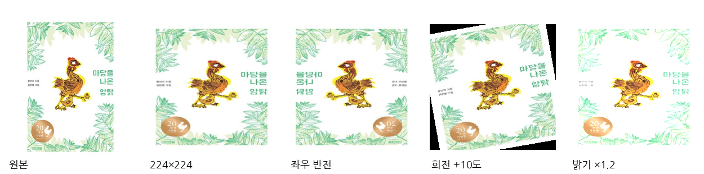
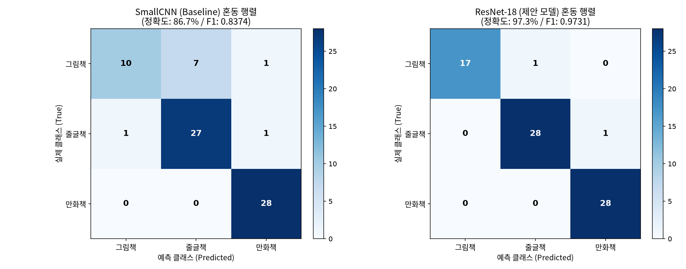
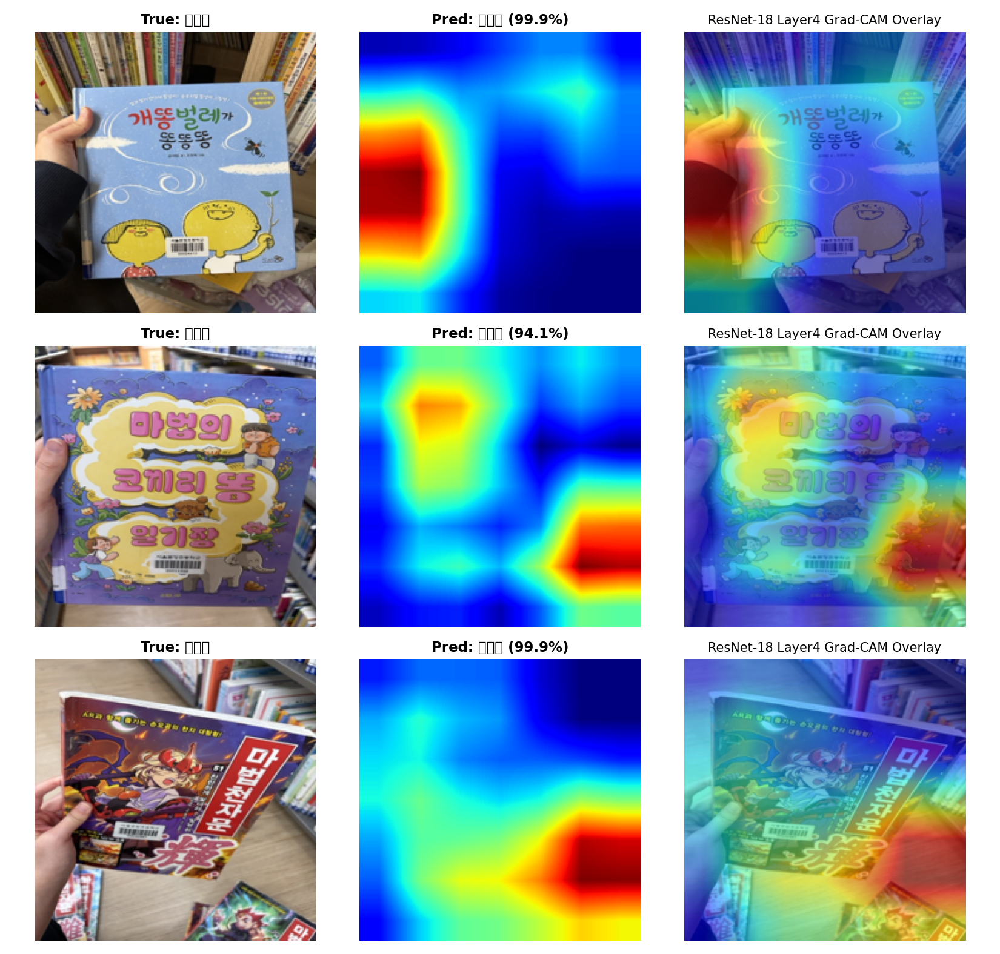
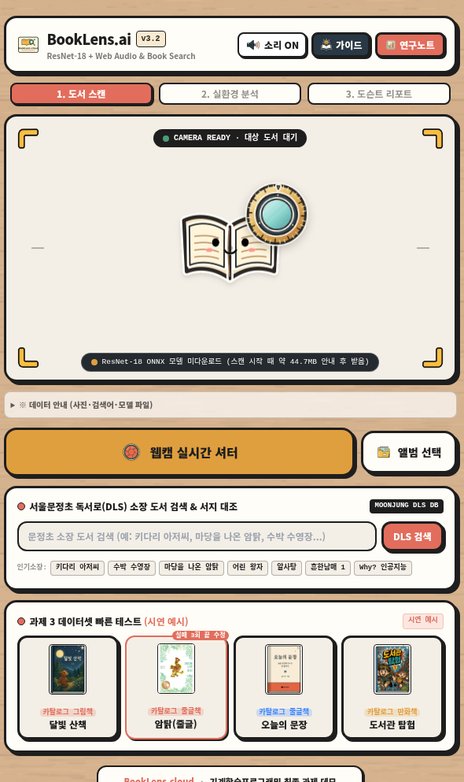
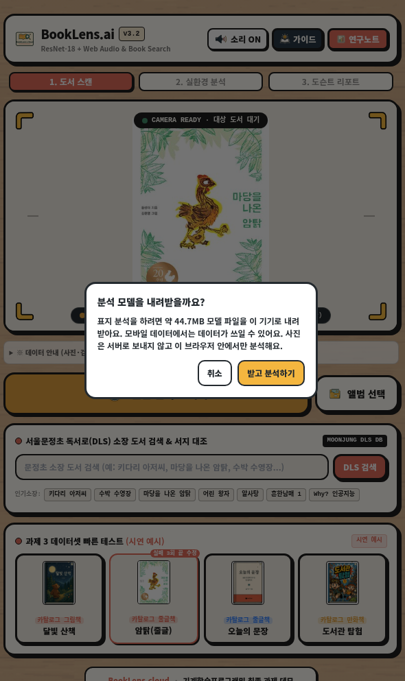
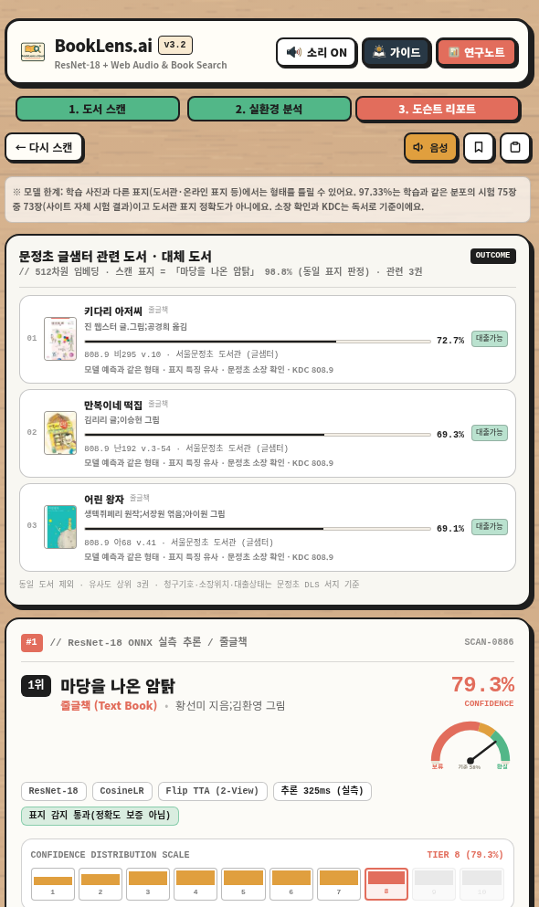

# BookLens AI: 표지 한 장으로 문정초 소장 관련 도서까지 찾아주는 도서관 렌즈

## 0. 프로젝트 정보
- **학번 / 성명**: 202533791 윤나래 (가천대학교 IT융합대학 컴퓨터공학과 2학년, 전자공학 복수전공)
- **데모 공개 URL**: https://booklens.cloud (Cloudflare Workers)
- **GitHub 저장소**: https://github.com/yn2511/booklens
- **수업 / 지도교수**: 기계학습프로그래밍, 조윤실 교수님 (2026-2학기)
- **한 줄 정의**: 책 표지를 카메라로 비추면 ① 책이 맞는지 먼저 판별하고(OOD 게이트) ② ResNet-18 512차원 임베딩으로 문정초 글샘터 소장 도서 21권 중 **관련·대체 도서 3권을 추천**하며 ③ 청구기호·소장위치·대출상태까지 안내하는 웹 서비스.

> v1 지표는 저장된 노트북 출력, 서비스 실측은 11/14 기록입니다. 11/18 같은 데이터 재실행은 별도 회차로 구분합니다. 새 책·새 환경의 독립 평가가 아닙니다. 측정하지 않은 값은 미측정으로 적습니다.

---

## 1. 문제 정의

### (1) 현장에서 출발한 질문
문정초등학교 글샘터 도서관 이용자가 제목을 정확히 기억하지 못해도, 표지에서 출발해 비슷한 소장 도서를 찾도록 하는 것을 목표로 했습니다. 이용 빈도나 만족도를 조사한 것은 아닙니다.

이 문제는 초등학교만의 것이 아닙니다. 대학생이 과제를 위해 도서관에서 책을 고를 때, 교수님이 서점에서 다음 읽을 책을 고를 때도 똑같습니다.
검색창은 제목을 알아야 하고, 바코드는 서가에 꽂혀 있는 책에는 쓸 수 없습니다. 손에 든 표지 하나에서 출발해 "그 책과 비슷한, 우리 도서관에 있는 책"으로 이어지는 경로가 비어 있습니다.

### (2) 4W
- **Who**: 초등학교 도서관 이용자(학생, 학부모, 자원봉사자), 그리고 같은 문제를 겪는 일반 이용자.
- **What**: 표지만으로 ① 도서 여부 판별 ② 도서 형태(그림책/줄글책/만화책) 분류 ③ 소장 도서 중 관련 도서 추천 ④ 서가 위치·대출상태 안내.
- **When**: 서가 앞에서 책을 고를 때, 읽은 책의 다음 책을 찾을 때.
- **Why**: 텍스트 검색은 불완전한 기억에 취약하고, ISBN·바코드 입력은 서가의 책에 적용하기 어렵다.

### (3) 기존 서비스와 다른 점
1. **분류(Output)에서 추천(Outcome)으로**: "이 책이 그림책인지 줄글책인지"는 사람이 눈으로도 아는 정보입니다. 서비스가 실제로 제공해야 하는 것은 그 다음 질문("그래서 다음엔 뭘 읽지?")에 대한 답입니다.
2. **비도서 차단 게이트**: 단색·암전·노이즈·바닥은 브라우저 검사에서 차단했습니다. 화면·문서·도면은 통과할 수 있어 도서 여부를 보장하지 않습니다. 실패 사례는 5절에 적었습니다.
3. **설명 가능성의 분리**: 실제 역전파 Grad-CAM(학습 산출물)과 브라우저 캔버스 휴리스틱(실시간 화면)은 이름과 근거가 다르므로 UI에서도 다르게 표기합니다.
4. **학교 도서관 서지(DLS) 연계**: 모델 판정과 독서로 소장 조회를 따로 보여 줍니다. 조회로 가져오는 것은 제목·저자·청구기호·소장위치·대출상태 등이며, 그림책/줄글책/만화책 정답 라벨을 조회하는 것은 아닙니다. 독서로 전체에 판형 항목이 있는지는 확인하지 못했습니다.

### (4) 정량 목표와 달성도
| 항목 | 목표 | 실측 |
| :--- | :--- | :--- |
| 테스트 정확도 | ≥ 90.0% | **97.33%** (73/75, 노트북 자체 시험 결과, 독립 재검증 아님) |
| Macro-F1 | ≥ 0.90 | **0.9731** |
| 비도서 차단 | 어두운 배경·단색 배경 차단 | 단색·암전·노이즈·바닥 **4/4 차단**(브라우저 실측) |
| 관련 도서 추천 | 소장 도서 Top-3 안에 같은 분야 도서 | 자기 입력 검사만 수행: 자기 표지 재식별 98.8~100%, 최대 비동일 유사도 0.813. 같은 분야 추천 목표의 달성 여부는 미확인 |
| 브라우저 추론 지연 | 정량 목표 미설정 | 11/18 화면에 325ms가 보이나 단일 사례이며 반복 지연 평가는 미측정 |

---

## 2. 데이터

### (1) 출처 및 규모
- **표지 데이터**: 기계학습프로그래밍 과제 3의 공식 데이터셋 `book_dataset` **494장** 계승.
  - 그림책 118장 / 줄글책 192장 / 만화책 184장.
- **서비스 서지 데이터**: 서울문정초등학교 글샘터 도서관 소장 도서 **21권**.
  - 청구기호, 등록번호, 소장위치, 대출상태, KDC 분류를 카탈로그로 정리.
  - 표지 이미지는 알라딘 표지 CDN 17권 + 시연용 자체 표지 4권(달빛 산책, 오늘의 문장, 도서관 탐험, 마당을 나온 암탉).
- **비도서(OOD) 평가셋**: 합성 10장(단색 5, 노이즈 2, 그라데이션, 문서 모사, 바닥 타일) + 실사 5장(3D 렌더, 문서 화면, 제품 사진, 도면, 3D 편집 화면).

### (2) 라벨 정의
표지에서 시각적으로 구분되는 세 가지 판형 기준입니다.
그림책(삽화 중심, 텍스트 최소) / 줄글책(문고·단행본, 텍스트 비중 높음) / 만화책(칸 구성, 캐릭터 중심).

### (3) 분할
- 계층적 분할(Stratified, `seed=42`): **Train 345 / Val 74 / Test 75**.
- 노트북은 학습·검증·시험 파일 목록을 분리해 사용합니다. 다만 유사 사진 중복이나 원 수집 단계의 누수까지 검사한 것은 아닙니다.


### (4) 선정 이유와 이용조건
- 데이터 선정 이유: 과제 3에서 제공된 3개 클래스와 494장 규모를 이어받아, 스크래치 기준선과 전이학습 모델을 같은 분할에서 비교할 수 있었습니다. 도서관 추천 목표에 비해 표지 분포가 좁다는 한계가 있습니다.
- `book_dataset` 출처는 수업 과제 3입니다. 원 촬영자·수집 경로·외부 재배포 라이선스는 현재 자료에서 확인하지 못했습니다. 공개 데이터나 자유 이용 이미지라고 주장하지 않으며, 원본 494장은 이 저장소와 제출 ZIP에 재배포하지 않습니다. 재학습에는 수업에서 제공받은 데이터가 필요합니다.
- 알라딘 CDN 표지 및 서지, 서비스 화면 속 표지의 저작권은 권리자에게 있습니다. 표지 CDN 접근 가능성이 재배포 허락을 뜻하지 않습니다. 별도 공개 재이용 허락은 확인하지 못했습니다. 카탈로그의 자체 시연용 표지 구분은 기존 기록에 따르며 제3자 권리까지 보장하지 않습니다.
- 독서로는 웹 화면이 쓰는 비공식 검색 주소를 호출합니다. 학교 시스템 이용조건과 Cloudflare·독서로 쪽 기록 보관은 확인하지 못했습니다. 서비스 변경 시 조회가 중단될 수 있습니다.
- 라벨 부착자·독립 검수·학습/테스트 간 유사 사진 중복 여부도 미확인입니다. 파일 분할만으로 중복 부재가 입증되는 것은 아닙니다.

---

## 3. 데이터 전처리

1. **Resize(224×224) + ImageNet 정규화** — 학습·추론 모두 같은 방식으로 종횡비를 유지하지 않고 224×224로 맞춥니다. 브라우저도 같은 방식(`drawImage(img, 0, 0, 224, 224)`)이라 학습과 추론의 기본 크기·정규화 방식을 맞췄습니다. 이것만으로 실제 촬영 분포까지 같아지는 것은 아닙니다.
2. **RandomHorizontalFlip(p=0.5), RandomRotation(±10°)** — 손으로 든 채 조금 기울어 찍히는 상황을 견디게 합니다.
3. **ColorJitter(brightness=0.2, contrast=0.2, saturation=0.2)** — 형광등 반사와 손가락 그림자로 밝기·채도가 급변하는 상황을 견디게 합니다.

> 이전 문서에는 `RandomPerspective(distortion_scale=0.35)`와 letterbox 패딩을 적용했다고 적혀 있었으나, 실제 학습 노트북(`notebooks/BookLens_AI_최종프로젝트.ipynb`)에는 해당 변환이 없습니다. 문서를 코드에 맞춰 정정했습니다.


### 전처리 전·후 비교
아래는 저장소의 시연용 표지 `assets/cover_hen_optimized.jpg`에 실제 학습 코드와 같은 종류의 변환을 적용해 만든 설명용 비교입니다. 학습 데이터 원본이나 과거 학습 중 저장된 증강 결과가 아닙니다. 무작위 값을 재현한 학습 실험이라고도 주장하지 않습니다.



| 단계 | 전 → 후 | 적용 범위와 주의 |
| :--- | :--- | :--- |
| Resize | 원본 종횡비 → 224×224, 가로세로를 각각 맞춤 | 학습·검증·시험·브라우저 입력 |
| 좌우 반전 | 원본 방향 → 거울상 | 학습 때 확률 0.5; 표지 글자도 반전됨 |
| 회전 | 정방향 → 예시 +10도 | 학습 범위 ±10도; 예시 바깥 부분은 검게 채움 |
| 밝기·대비·채도 | 원본 → 예시는 밝기 1.2배 | 학습 ColorJitter 각 0.2; 예시는 밝기만 따로 보임 |
| 정규화 | RGB/255 → (값−평균)/표준편차 | 평균 [0.485,0.456,0.406], 표준편차 [0.229,0.224,0.225]. 이미지 밝기 결과가 아니라 텐서 수치 변환 |

이 비교는 변환의 차이를 설명합니다. 증강 유무의 정확도 개선을 분리해 측정한 실험은 하지 않았습니다.

---

## 4. 모델

### (1) 두 모델 비교 (루브릭: 자체 모델 2개 이상)
| 구분 | 모델 | 파라미터 수 | 특징 |
| :--- | :--- | :---: | :--- |
| Baseline | SmallCNN (Scratch) | **94,083** | Conv 3단 + GAP + Dropout(0.4) + FC. 사전학습 없음 |
| Proposed | ResNet-18 (ImageNet 전이학습, 전체 파인튜닝) | **11,178,051** | 잔차 연결, CosineAnnealingLR, 마지막 GAP 출력 512차원을 임베딩으로 사용 |

> **배포 모델 기준 (v1 고정)**: booklens.cloud에 배포된 모델은 이 문서의 ResNet-18(v1, Test 97.33% / Macro-F1 0.9731)입니다. `models/booklens_resnet18.onnx`와 `data/catalog_embeddings.json`은 모두 v1 산출물입니다. `notebooks/BookLens_재학습_v2.ipynb`(Test 96.00%, 6에폭 조기종료)와 드라이브 `BookLens_Models_Backup`의 v2 ONNX는 배포용이 아니라 Val Loss·Train Acc·조기종료 로직 검증을 위한 재학습 기록입니다.

### (2) 학습 설정
- Optimizer: AdamW, weight_decay=1e-2. SmallCNN lr=1e-3, ResNet-18 lr=1e-4 (실제 호출값 기준)
- Scheduler: CosineAnnealingLR (T_max=8, eta_min=1e-6)
- Epoch 8, Batch 16, CrossEntropyLoss, 검증 Macro-F1 기준 최고 가중치 저장
- 디바이스: v1 저장 출력은 CPU입니다. CPU 학습 시간은 SmallCNN 357.9초, ResNet-18 547.5초로 기록됐습니다. 11/18 재실행 화면에는 T4 (Python 3) 런타임 표시가 있었지만 이 표시만으로 학습 텐서의 CUDA 사용까지 입증되지는 않습니다. seed 42 고정.

### (3) 512차원 임베딩을 출력으로 추가
학습이 끝난 뒤 ONNX 그래프에서 `/avgpool/GlobalAveragePool → Flatten` 지점(512차원)을 두 번째 출력 `embedding`으로 노출했습니다.
- 기존 `output`(3차원 로짓)은 **비트 단위로 동일**함을 확인했습니다(원본과 두 출력 모델에 같은 입력을 넣어 `tobytes()` 비교, 3회 반복 모두 일치).
- 파일 크기: 44,702,720 → 44,702,744 bytes (+24 bytes, 그래프 출력 정의만 추가).
- 원본(로짓 전용) 모델은 `downloads/booklens_resnet18_원본_logits전용.onnx`로 백업했습니다.

각 순전파에서 분류와 추천용 임베딩을 함께 얻습니다. 현재 브라우저는 원본과 좌우 반전 입력을 각각 실행하는 Flip TTA(2-View)를 사용하므로 사진 한 장당 모델 실행은 2회입니다.

선정 이유: 같은 75장 시험에서 정확도와 Macro-F1이 모두 높은 ResNet-18을 최종 모델로 골랐습니다. SmallCNN은 사전학습 없이 작은 기준선을 만들기 위한 비교군입니다. 두 모델은 규모와 사전학습 유무가 함께 달라, 개선 원인을 둘로 분리하지는 못했습니다.

---

## 5. 평가 결과

### (1) 테스트셋 75장 실측
| 모델 | 파라미터 | Test Accuracy | Macro-F1 | 비고 |
| :--- | :---: | :---: | :---: | :--- |
| SmallCNN (Baseline) | 94,083 | 86.67% | 0.8374 | 그림책↔줄글책 혼동 다수 |
| **ResNet-18 (Proposed)** | **11,178,051** | **97.33%** | **0.9731** | 오분류 2건 (73/75) |

11/18 같은 데이터·분할 재실행에서는 SmallCNN 88.00% / Macro-F1 0.8607, ResNet-18 97.33% / 0.9731을 확인했습니다. 위 표는 v1 저장 출력이며 서로 다른 회차를 섞지 않았습니다.

### (2) 클래스별 (ResNet-18)
| 클래스 | Precision | Recall | F1 | Support |
| :--- | :---: | :---: | :---: | :---: |
| 그림책 | 1.0000 | 0.9444 | 0.9714 | 18 |
| 줄글책 | 0.9655 | 0.9655 | 0.9655 | 29 |
| 만화책 | 0.9655 | 1.0000 | 0.9825 | 28 |
| Macro | 0.9770 | 0.9700 | 0.9731 | 75 |



혼동 행렬: `docs/confusion_matrix.png`. 오분류 2건은 그림책→줄글책 1건, 줄글책→만화책 1건입니다.

### (3) Grad-CAM (실제 역전파)

`layer4[-1]`에 forward/backward hook을 걸어 채널별 기울기 평균을 활성화 맵에 곱한 정규 Grad-CAM입니다(`docs/gradcam_real_results.png`).
- 주의: 이 그림의 제목 줄(`True:` / `Pred:`)은 Colab matplotlib에 한글 폰트가 없어 □□□로 저장됐습니다. **히트맵과 표지 사진 픽셀은 원본 그대로이며 손대지 않았습니다.** 클래스별 수치는 위 지표표와 혼동 행렬로 확인할 수 있습니다.

### (4) OOD 게이트 실측 (2026-11-14)
로짓 기반 Free Energy `E(x) = -log Σ exp(logit_i)`(T=1)와 물리 지표를 실제 이미지에서 측정했습니다.

| 구분 | 표본 | 휘도 표준편차 | 엣지 밀도 | logSumExp |
| :--- | :---: | :--- | :--- | :--- |
| 문정초 표지 | 21장 | 37.5 ~ 97.1 | 0.115 ~ 0.777 | 0.77 ~ 3.10 |
| 비도서 배경 | 10장 | 0.0 ~ 28.1 | 0.000 ~ 0.898 | 0.92 ~ 1.88 |

- 임계치: 휘도 표준편차 34 미만, 엣지 밀도 0.06 미만, 중앙 엣지 밀도 0.05 미만, logSumExp 0.60 미만이면 차단.
- 결과: 표지 **21/21 통과**, 합성 비도서 **10장 중 9장 차단**(문서 모사 1장은 통과), 실사 문서·도면 5장은 2장 차단 / 3장 통과.
- 브라우저 실측: 단색 회색/암전/노이즈/바닥 4종 모두 차단, 실제 표지(마당을 나온 암탉)는 통과(logSumExp 1.75).
- **한계**: 화면 캡처·문서·도면처럼 텍스처가 조밀한 비도서는 통과합니다. 문서 화면 logSumExp 2.53, 도면 2.52로 실제 표지와 비슷한 값이 나옵니다(3D 렌더는 0.58로 차단). 로짓 신뢰도는 "도서다움"의 지표가 아닙니다.

### (5) 관련 도서 추천 검증
- 소장 21권 표지를 각각 넣었을 때 자기 표지가 1순위로 나오고 유사도는 98.8~100%였습니다. 자기 표지를 다시 넣은 검사이므로 독립적인 추천 품질 평가가 아닙니다.
- 서로 다른 책 사이의 최대 유사도는 **0.813**(흔한남매 1 ~ 도서관 탐험 1)입니다. 같은 표지 판정선을 0.95로 두면 "동일 도서"와 "다른 도서"가 0.14 이상 떨어져 분리됩니다.

---

## 6. 서비스 프로토타입

### (1) 동작 방식
1. 스캔을 시작할 때 모델 다운로드(약 44.7MB) 동의를 받고, 동의하면 브라우저가 ONNX Runtime Web(WASM)으로 `models/booklens_resnet18.onnx`를 내려받아 세션을 만듭니다(1회). 페이지를 열기만 해서는 받지 않으며, 취소하면 분석하지 않습니다. 사진은 브라우저 안에서만 분석하고, 도서명 검색어만 Cloudflare Worker를 거쳐 독서로(read365.edunet.net)로 전달되어 최대 10분 임시 캐시됩니다. 앱 코드에는 저장·로그 기능이 없고 Cloudflare·독서로 쪽 기록은 확인하지 못했습니다.
2. 표지를 촬영·업로드하면 224×224 텐서로 만들어 원본과 좌우 반전 **2회 추론(Flip TTA)**을 합니다. 각 실행에서 로짓(3)과 임베딩(512)을 함께 얻습니다. 분류·에너지에는 두 뷰를 사용하고, 추천 임베딩은 원본 뷰에서 가져옵니다.
3. OOD 게이트가 통과시키면 512차원 임베딩을 L2 정규화하고, 문정초 소장 21권의 사전계산 임베딩과 코사인 유사도를 계산해 **상위 3권**을 보여줍니다.
4. 유사도 0.95 이상이면 "같은 표지"로 판정해 그 책을 추천에서 빼고, 도서명·저자를 DLS 서지로 바로잡습니다.
5. 각 추천 카드에 표지 실물 썸네일, 저자, 유사도(%), 청구기호, 소장위치, 대출가능 여부, 그리고 "모델 예측과 같은 형태 / 예측 형태와 다름 · 표지 특징 유사 · 문정초 소장 확인 · KDC 번호"를 표시합니다. 주제가 같다는 뜻은 아닙니다.

### (2) 화면 캡처와 사용 예
다음 표와 수치 예시는 11/14 검사 기록입니다. 아래 삽입한 세 장은 11/18 발표자료에 사용한 실제 서비스 화면입니다. 과거 캡처의 DLS 교차검증 표현을 현재의 분류 정답 보장으로 해석하지 않습니다.

| 파일 | 내용 |
| :--- | :--- |
| `docs/ui_step1_scan.png` | 1단계 스캔 화면 |
| `docs/ui_step3_outcome.png` | 3단계 리포트 전체 (상단 관련 도서 추천 + 모델 판정 + DLS 대조) |
| `docs/ui_outcome_card.png` | 관련 도서 추천 카드 확대 |
| `docs/ui_step3_catalog_cover.png` | 어린 왕자 표지로 스캔했을 때의 추천 결과 |
| `docs/ui_dls_card.png` | DLS 교차 검증 카드(스캔 표지 = 마당을 나온 암탉 98.8%) |
| `docs/ui_ood_gate.png` | 비도서(단색) 차단 화면 |

- 실측 예시 ①  마당을 나온 암탉 표지 → 로짓 `[-1.60, 1.57, -0.28]`, logSumExp 1.75, Free Energy -1.75, OOD PASSED, 줄글책 83.4%, 같은 표지 98.8% → 추천: 키다리 아저씨 72.7% / 만복이네 떡집 69.3% / 어린 왕자 69.1%.
- 실측 예시 ②  어린 왕자 표지 → 같은 표지 99.6% → 추천: 수박 수영장 71.5% / 키다리 아저씨 69.8% / Why? 인공지능 69.0%.
- 실측 ③  단색 회색 이미지 → logSumExp 0.92, 휘도 표준편차 0.0, 엣지 밀도 0.0% → "평면 단색 배경"으로 차단.







사용 안내: 사이트에서 스캔을 시작하고 모델 다운로드에 동의한 뒤 사진을 선택합니다. 모델 결과와 관련 도서를 확인하고, 제목으로 독서로 조회를 따로 실행해 소장 여부를 확인합니다. 취소하면 모델을 받지 않습니다. 카메라 권한이 없으면 앨범 사진 경로를 이용합니다.

### (3) 알려진 한계
- 화면 캡처, 문서 스캔, 도면은 표지처럼 텍스처가 조밀해 게이트를 통과합니다. 실제 측정에서 문서 화면은 logSumExp 2.53, 도면은 2.52로 실제 표지 상당값이 나왔습니다.
- 21권 밖의 책은 관련 도서 유사도가 낮게(0.6~0.8) 나오므로 추천 품질이 떨어집니다. 카탈로그 확대가 개선으로 이어지는지는 별도 평가가 필요합니다.
- 카메라 실시간 웹캠 경로는 이번 검증에서 자동화하지 못했습니다(파일 업로드 경로만 실측). 휴대폰 실기기·학교망·모델 다운로드 실패 경로도 최신 버전에서 미확인입니다.
- 내장 21권 중 모델 판형과 등록 라벨이 일치한 것은 12권이었습니다. 등록 라벨 자체도 독립 검증하지 않았으므로 실환경 정답률로 사용하지 않습니다.

---

## 7. 배포
- 플랫폼: Cloudflare Workers (정적 단일 번들 + `/models/*.onnx` · `/data/*.json` 연동), 주소 `https://booklens.cloud`.
- 사전계산된 21권 임베딩·썸네일을 `data/catalog_embeddings.json`(135KB)으로 외부 분리해 `index.html` 번들 크기를 줄였습니다(현재 약 1.06MB, 동의 안내 추가 이후 기준).

---

## 8. 실행 방법

### (1) 환경
- Python 3.10+, PyTorch 2.x, torchvision, scikit-learn, onnx, onnxruntime, Pillow, matplotlib
- 학습: Google Colab GPU 권장

### (2) 파일
```
booklens/
├── index.html                      # 웹앱 UI 및 ONNX 추론 · OOD · 추천 로직
├── data/catalog_embeddings.json    # 문정초 소장 21권 사전계산 512차원 임베딩·썸네일
├── models/booklens_resnet18.onnx   # 출력 2개: output(3) + embedding(512)
├── notebooks/BookLens_AI_최종프로젝트.ipynb
├── notebooks/BookLens_재학습_v2.ipynb     # 검증용 재학습(배포 아님): Val Loss·Train Acc·조기종료 로직 검증
├── requirements.txt
├── submission.json
└── docs/                           # 혼동행렬, Grad-CAM, UI 캡처, 발표 노트
```

### (3) 실행
```bash
pip install -r requirements.txt

# 1) 학습·평가·ONNX 내보내기: notebooks/BookLens_AI_최종프로젝트.ipynb 순차 실행

# 2) 로컬 웹 실행 (models/ 및 data/ 경로 때문에 HTTP 서버로 실행)
python3 -m http.server 8080
# http://localhost:8080 접속
```

---

## 9. Lessons Learned

### (1) PMI
**Plus**

- 전이학습과 512차원 임베딩을 같은 순전파에서 뽑아, 분류기 하나로 "판별 + 추천" 두 가지 일을 하게 만들었다. 사진 추론은 브라우저에서 하고 소장 검색은 별도 프록시를 이용한다.
- 실측으로 확인한 개선(86.67% → 97.33%)과 실측으로 확인한 실패(비도서 오탐, OOD 수식 버그)를 모두 기록해 두었다. 저장 출력과 서비스 검사 기록을 구분해 설명할 수 있다.

**Minus**

- 데이터가 494장뿐이라 학습 표지 분포가 좁다. 서비스에 넣은 실제 도서관 표지는 학습 데이터가 아니어서, 분류 편향(대부분을 줄글책으로 판정)이 그대로 드러났다. 이 편향은 임베딩 추천이 가려줄 뿐 없앨 수 없다.
- OOD를 "로짓 에너지" 하나로 해결하려 한 것이 큰 오판이었다. 에너지는 문서·화면 같은 조밀한 비도서를 걸러내지 못한다.

**Interesting**

- 표지 인식에서 진짜 어려운 것은 "무엇인지 맞히기"가 아니라 "무엇이 아닌지 거르기"였다. 실제로 단색 배경은 막았지만 문서·도면 3장은 통과했다.
- 임베딩 공간에서는 같은 표지가 0.99, 다른 표지가 0.6~0.8에 놓인다. 자기 입력과 다른 책의 유사도 차이는 확인했지만, 그 값이 이용자가 원하는 추천 품질과 같은 뜻은 아니라는 점도 배웠다.

### (2) 고민·실패·수정 연대기

**① FitFinder에서 BookLens로 피벗**
처음에는 패션 이미지를 색·카테고리·스타일로 동시에 분류하는 멀티태스크 모델을 기획했다. 교수님 피드백은 "프론트는 생성형 AI가 다 해준다, 데이터를 어떻게 모으고 모델을 어떻게 학습시켰는지에 집중하라"였다. 이미 라벨이 붙은 과제 3의 도서 데이터셋을 계승하는 쪽이 데이터 수집·전처리·학습의 전 과정을 실제로 거칠 수 있어 BookLens로 방향을 바꿨다.

**② 11/7 가설 수치 감사: 문서에 있던 숫자가 실측이 아니었다**
발표를 준비하다 "이 숫자 실제로 돌린 값이 맞나"를 확인했더니, 제출 노트북의 셀은 전부 미실행 상태였고 README의 96.67%, Val Loss 0.124, AUROC 0.934 같은 값은 설계 단계의 목표치였다. 그날 밤 Colab에서 494장을 실제로 학습해 97.33%를 얻고, 가설 수치는 문서·코드·발표자료에서 전부 걷어냈다. 이 경험 뒤로는 "측정하지 않은 값은 쓰지 않는다"가 규칙이 됐다.

**③ OOD 3연속 실패 → 6단계 게이트 → 수식 버그**
"책이 아닌 걸 찍어도 안 걸러진다"는 지적을 세 번 받았다. 확률 마진만 보는 가드는 차량 실내를 그림책으로 판정했고, 물리 지표를 붙여도 바닥 타일이 통과했다. 그렇게 만든 6단계 게이트(암전/단조로움/균일노이즈/중앙텍스처/에너지/마진)를 웹 ONNX로 옮기고 나서는 반대 사고가 났다. 실제 책 표지가 전부 `OOD: FAILED`로 막힌 것이다. 원인은 `-log(exp(p1)+exp(p2)+exp(p3))`처럼 **소프트맥스 확률에 로그를 취한 것**이었다. 확률은 0~1이라 결과가 항상 -1.5 근처로 고정되고, 임계치 3.25를 넘지 못해 전부 차단됐다. 로짓으로 계산하도록 고치고(`E = -logsumexp(logits)`), 실제 표지 21장과 비도서 10장을 재어 임계치를 다시 잡았다. 이때 "마진·확신도는 차단 근거로 쓰지 않는다"는 결론도 얻었다. 실제 표지 중에도 마진이 0.002까지 떨어지는 책(수박 수영장)이 있었기 때문이다.

**④ 삽화 많은 아동문고 표지의 모호성 → 모델과 서지 결과 분리**
삽화 많은 표지는 그림책과 줄글책 사이에서 모호했습니다. 문제는 모델 판정과 도서관 서지를 하나의 정답처럼 합쳐 보이는 것이었습니다. 그래서 사진 기반 판정과 독서로의 소장 조회 결과를 따로 표시합니다. 독서로는 소장 여부·청구기호·대출상태 확인에 쓰며, 시각 분류의 정답을 보증하는 근거로 쓰지 않습니다.

**⑤ Saliency와 Grad-CAM의 이름을 분리**
브라우저에서 실시간으로 그리는 히트맵은 캔버스 픽셀 통계로 만든 휴리스틱이다. 이것을 Grad-CAM이라고 부르면 거짓말이 된다. 화면에는 "캔버스 Saliency"로 표기하고, 실제 역전파 Grad-CAM은 학습 산출물(`docs/gradcam_real_results.png`)로만 제시한다.

**⑥ Output에서 Outcome으로**
"손에 든 책이 그림책인지 줄글책인지"는 사람 눈으로도 알 수 있는 Output이었다. 도서관 현장의 요구는 그 다음 질문, 즉 "이 책과 비슷한 우리 도서관 책"이었다. 그래서 최종 산출물을 3분류 라벨이 아니라 **ResNet-18 512차원 임베딩 유사도 + DLS 서지 연계 관련 도서 추천**으로 다시 정의했다. 모델은 그대로 두고, 같은 순전파에서 나온 512차원 벡터를 서비스의 답으로 쓰기 시작한 것이 이 프로젝트의 전환점이다.

### (3) 다음에 할 것
- 소장 도서 카탈로그 확장(현재 21권)과 함께 임베딩 재계산 자동화.
- 조밀 텍스처 비도서(화면·문서) 차단: OCR 텍스트 라인 주기성이나 화면 촬영 특유의 무아레 패턴처럼 물리량을 늘리는 방향.
- 웹캠 실시간 경로 자동 검증, 모바일 실기기 지연 측정.
- ONNX INT8 양자화로 44.7MB 모델 경량화(정확도 손실 측정 선행).
